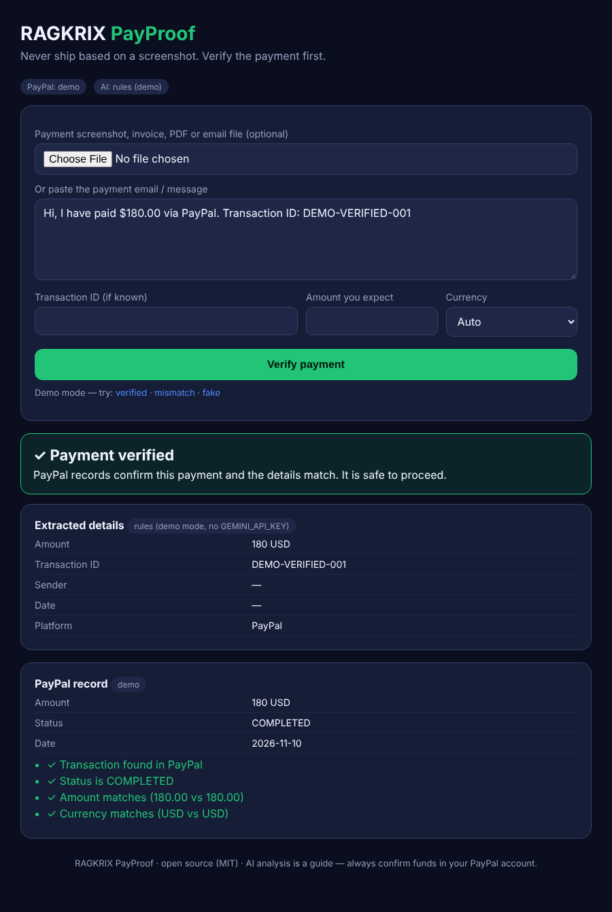

# RAGKRIX PayProof — AI Payment Verification Assistant

> **Never ship based on a screenshot. Verify the payment first.**

RAGKRIX PayProof protects freelancers, small businesses, online sellers and individuals from fake payment confirmations. Scammers send edited payment screenshots, forged emails and misleading "payment pending" messages; sellers who believe them ship products or deliver services and never receive the money.

PayProof combines **AI document understanding** with **PayPal transaction verification**. Upload a payment screenshot, invoice or email. The AI pulls out the payment details and flags warning signs, then PayProof checks the claim against your actual PayPal records and gives one clear result:

| Result | Meaning |
|---|---|
| ✅ **Verified** | The transaction exists in PayPal, is `COMPLETED`, and the amount and currency match the proof. |
| ⚠️ **Mismatch** | A transaction exists, but the amount, currency or status does not match (e.g. a $18 payment shown as $180, or a `PENDING` payment). |
| ❔ **Unable to verify** | No matching PayPal transaction was found. Treat the proof as unconfirmed. |



---

## How PayPal is used

PayProof uses the **PayPal REST APIs** (`payproof/paypal_client.py`) to confirm payments against real records instead of trusting a screenshot:

1. **OAuth 2.0 client credentials** — `POST /v1/oauth2/token` gets an access token from your PayPal app's Client ID and Secret.
2. **Payments API, capture lookup** — `GET /v2/payments/captures/{id}` fetches the transaction by the ID found in the proof and reads its amount, currency and status.
3. **Transaction Search API (fallback)** — `GET /v1/reporting/transactions?transaction_id=…` searches the last ~90 days, in 31-day windows, when the ID is not a capture ID.

`payproof/verifier.py` then compares the claimed payment with the PayPal record (transaction found, status `COMPLETED`, amount match, currency match) and produces the verdict.

The app runs against the **PayPal Sandbox** by default (`PAYPAL_ENV=sandbox`). Set `PAYPAL_ENV=live` with live credentials for real accounts.

## How AI is used

`payproof/ai_extractor.py` sends the uploaded screenshot, PDF or email text to **Google Gemini** (`gemini-2.5-flash`, multimodal) with a fraud-analyst prompt. Gemini returns structured JSON:

- **Extracted details:** amount, currency, sender name and email, recipient, transaction ID, date and payment platform.
- **AI warning signs:** edited or mismatched fonts, spoofed sender domains, inconsistent dates or currencies, pressure tactics and other signs that the proof is fake.

`payproof/risk.py` adds rule-based checks for common scam patterns: urgency language, "overpayment, please refund the difference", "funds released once you ship", look-alike PayPal email domains, and missing transaction IDs.

If no `GEMINI_API_KEY` is set, a rule-based extractor reads pasted text so the app still works in demo mode.

## Architecture

```
Browser (templates/index.html)
   │  POST /api/verify  (file and/or text, optional transaction ID & expected amount)
   ▼
app.py (Flask)
   ▼
payproof/verifier.py ──► ai_extractor.py ──► Google Gemini API
          │          └─► risk.py (rule-based warning signs)
          └────────────► paypal_client.py ──► PayPal REST APIs (OAuth, Payments, Transaction Search)
   ▼
JSON verdict: VERIFIED | MISMATCH | UNABLE_TO_VERIFY + extracted details + checks + warning signs
```

## Setup

**Requirements:** Python 3.10+

```bash
git clone https://github.com/<your-username>/ragkrix-payproof.git
cd ragkrix-payproof
python -m venv .venv
source .venv/bin/activate        # Windows: .venv\Scripts\activate
pip install -r requirements.txt
cp .env.example .env             # then fill in your keys (optional for demo mode)
python app.py
```

Open http://localhost:5000.

### Credentials (`.env`)

| Variable | Where to get it |
|---|---|
| `PAYPAL_CLIENT_ID`, `PAYPAL_CLIENT_SECRET` | [PayPal Developer Dashboard](https://developer.paypal.com/dashboard/applications) → Apps & Credentials → create a Sandbox app |
| `PAYPAL_ENV` | `sandbox` (default) or `live` |
| `GEMINI_API_KEY` | [Google AI Studio](https://aistudio.google.com/apikey) |

Leave the PayPal values blank to use **demo mode**, which checks against built-in sample records.

### Testing with the PayPal Sandbox

1. Create a Sandbox app in the PayPal Developer Dashboard and copy its Client ID and Secret into `.env`.
2. Make a test payment between your sandbox buyer and merchant accounts, using the sandbox site or the Orders API.
3. Copy the capture or transaction ID from the sandbox merchant account and paste it into PayProof with the amount you expect.
   Note: new sandbox transactions can take a few hours to appear in the Transaction Search API; capture lookups are immediate.

### Demo mode test IDs

| Transaction ID | Expected result |
|---|---|
| `DEMO-VERIFIED-001` ($180.00 USD, completed) | Verified when you claim $180 |
| `DEMO-PARTIAL-002` ($18.00 USD) | Mismatch when you claim $180 |
| `DEMO-PENDING-003` ($250.00 USD, pending) | Mismatch (not completed) |
| anything else | Unable to verify |

### Run tests

```bash
pytest -q
```

## API

`POST /api/verify` (multipart form)

| Field | Required | Description |
|---|---|---|
| `file` | one of file/text | PNG, JPG, WEBP, PDF, TXT or EML |
| `text` | one of file/text | Pasted payment message or email |
| `transaction_id` | no | Overrides the ID the AI extracts |
| `expected_amount`, `expected_currency` | no | The amount you are owed; overrides the claimed amount |

Returns `{verdict, explanation, extracted, paypal_record, checks[], warning_signs[], paypal_mode}`.

`GET /health` → `{"status": "ok"}`

## Deploy (Render)

`render.yaml` is included. On [Render](https://render.com): **New → Blueprint →** select this repo, then add `PAYPAL_CLIENT_ID`, `PAYPAL_CLIENT_SECRET` and `GEMINI_API_KEY` as environment variables. It starts with `gunicorn app:app`.

## Tools & technologies

- **PayPal REST APIs:** OAuth 2.0, Payments v2 (captures), Transaction Search (Reporting)
- **Google Gemini API:** multimodal document understanding
- **Python, Flask, Requests, Gunicorn, pytest**
- **Render:** hosting via `render.yaml`

## Security & privacy

- API keys are read from environment variables and never sent to the browser. `.env` is git-ignored.
- PayProof only **reads** PayPal transaction data. It never moves money.
- Uploaded files are processed in memory and not stored.
- The AI result is guidance. The PayPal record is the source of truth.

## Roadmap

- PayPal webhooks (`PAYMENT.CAPTURE.COMPLETED`) for instant confirmations
- Telugu, Tamil and Hindi interface
- Browser extension and WhatsApp bot for checking proofs where scams arrive

## License

[MIT](LICENSE) © 2026 Raghav Toofan
